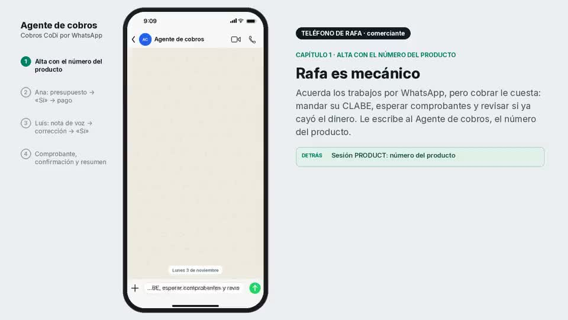
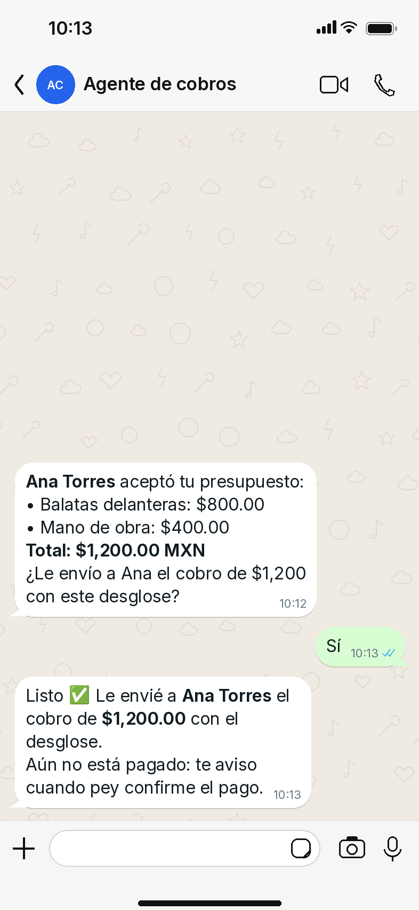

[](docs/ux/demo/ya-cayo-el-biyuyo.mp4)

**[▶ Ver video — Ya cayó el biyuyo (2:41)](docs/ux/demo/ya-cayo-el-biyuyo.mp4)** · Presentación del producto; no acredita un pago real ni la vinculación de WhatsApp.

# Ya cayó el biyuyo

**Cobros CoDi por WhatsApp para quien vive de su oficio.** Un agente observa los chats con clientes que el comerciante elige. Cuando detecta un trabajo acordado, le pregunta en privado si quiere enviar un QR de pey con el desglose. Solo con su "sí" lo envía al cliente correcto, y avisa cuando pey confirma el pago.

> **Estado:** solo diseño y plan. Todavía no hay aplicación, conexión a WhatsApp, cuentas registradas ni transacciones.



## El problema

Mecánicos, hojalateros, plomeros, electricistas y otros oficios cobran por WhatsApp: mandan una foto de su CLABE, el cliente la da de alta, transfiere y envía una captura. Después hay que cotejar las capturas contra el banco y recordar quién pagó en efectivo. El problema principal es **cobrar**, no administrar el taller.

## La propuesta

El comerciante habla con el agente en un chat con el número de WhatsApp del producto, «Agente de cobros», como con cualquier contacto. Sus clientes siguen hablando con él.

1. **Alta por WhatsApp:** el comerciante le escribe al número público del producto, da alias, nombre legal, CLABE y tipo de persona, y responde «Sí, autorizo». El agente la registra en pey y avisa que la activación puede tardar hasta cinco días hábiles.
2. **Detección:** el comerciante vincula su WhatsApp como dispositivo; en los chats elegidos, el agente identifica cuándo hay un trabajo y un monto acordados (texto primero; notas de voz opcionales).
3. **Autorización:** el agente le pregunta desde el número del producto, por ejemplo "¿Le envío a Ana el anticipo de $600?". Un **«Sí»** simple autoriza **un** cobro: el modelo entiende el lenguaje, pero el cliente, el monto y la versión salen del estado guardado. Si hay dos preguntas abiertas, el agente pregunta cuál.
4. **Cobro:** QR CoDi de monto fijo hacia la CLABE del comerciante, enviado desde el WhatsApp del comerciante, con su desglose, al cliente exacto.
5. **Confirmación:** un webhook firmado de pey, verificado contra la API, genera el aviso "Recibiste $600 (verificado por pey)", también desde el número del producto, con el saldo de la orden.

Una captura del cliente cuenta como *reportado, pendiente de verificar*, y el efectivo como *registrado por ti*. Solo pey confirma un pago.

## Cómo se ve



Ver el [flujo completo en pantallas](docs/ux/README.md) (maquetas ilustrativas con datos ficticios).

## Documentos

| Documento | Contenido |
|---|---|
| [docs/diseno.md](docs/diseno.md) | Uso, modelo de dominio, máquinas de estado, módulos, interfaces, esquema y reglas duras |
| [docs/implementacion.md](docs/implementacion.md) | Stack, cortes verticales con estimaciones, criterios de aceptación, puntos de corte, matriz de pruebas y demo |
| [docs/integraciones.md](docs/integraciones.md) | Contratos verificados de pey (8 nov 2026), webhooks, Baileys, OpenAI, versiones y pendientes |
| [docs/decisiones.md](docs/decisiones.md) | Alternativas comparadas y razones |
| [docs/diagramas.md](docs/diagramas.md) | Arquitectura, flujo de extremo a extremo y cuatro diagramas de estado |
| [docs/ux/README.md](docs/ux/README.md) | Flujo en 17 maquetas: alta con el número del producto, Rafa con su agente, dos clientes y el checkout CoDi (datos ficticios) |

## Stack sugerido

Node.js 24 LTS + TypeScript · Fastify · Baileys 7 · SQLite (WAL, `better-sqlite3`) · SDK de OpenAI con Zod · `standardwebhooks` · Vitest · Pino con redacción. Un solo servicio persistente con HTTPS y un volumen, sin Redis, colas externas ni microservicios. Ver [implementación](docs/implementacion.md#stack) y [decisiones](docs/decisiones.md).

## Alcance

**Incluye:** onboarding de la CLABE, órdenes con anticipo y saldo, QR CoDi, verificación de pagos, efectivo registrado y comprobantes reportados. Dos sesiones de WhatsApp en el mismo proceso: el número del producto, donde el comerciante habla con el agente, y el WhatsApp vinculado del comerciante, que lee a sus clientes y envía los cobros.

**No incluye:** ERP, inventario, facturación, diagnóstico, aprobación extra del cliente, links hospedados (sin `bankAccountId`), multi-sesión SaaS ni MCP de toda la API.

## Diagramas

Las fuentes canónicas son los archivos [`docs/diagrams/*.mmd`](docs/diagrams/). Los SVG, los PNG y [docs/diagramas.md](docs/diagramas.md) se generan con:

```bash
# Requiere Node >= 22.13 y Chrome; usa npx, sin dependencias en el repo
PUPPETEER_EXECUTABLE_PATH=/usr/bin/google-chrome node scripts/render-diagrams.mjs
node scripts/render-diagrams.mjs --check   # verifica que diagramas.md coincide con los .mmd
```

Para revisar los enlaces locales de la documentación: `python3 scripts/check-links.py`.

## Seguridad

Nunca se versionan secretos: la API key de pey, el secreto del webhook, la clave de OpenAI, la sesión de Baileys y las bases SQLite están excluidos en [.gitignore](.gitignore).
