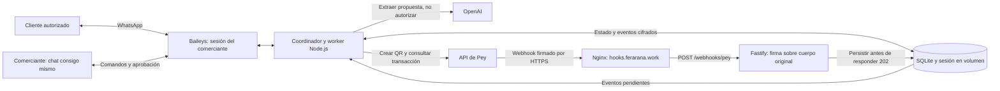

# Cobros CoDi por WhatsApp

Un coordinador de cobros para comerciantes: detecta acuerdos en chats autorizados, propone un cobro, exige aprobación del dueño y envía un QR CoDi de Pey. Un pago solo se acredita después de recibir un webhook firmado y consultar la API de Pey.

> **Estado al 8 de noviembre de 2026:** aplicación y despliegue implementados; la vinculación real de WhatsApp sigue bloqueada. No se ha validado un pago de extremo a extremo. `/health` y HTTPS funcionando no significan que el negocio esté listo para cobrar.

## Arquitectura del código actual



El [diseño del PR #1](https://github.com/feraranas/pey-hackathon/pull/1) y sus maquetas proponen **dos sesiones**: número del producto y número del comerciante. El código importado del commit `15075ba59ec1767d6a7a542de284c4680337cd1b` implementa **una sesión** y comandos en el chat propio. Este PR conserva esos documentos, pero no afirma haber implementado la experiencia de dos números.

## Probar sin cuentas ni pagos reales

Requiere Node 24 y herramientas de compilación para SQLite (Python 3, make y g++).

```bash
nvm use
npm ci
npm run check
npm test
npm run build
npm run demo
```

La demo usa proveedores simulados. No demuestra conectividad con WhatsApp ni confirma pagos reales. Para verificar también formato y enlaces: `npm run verify`.

## Configurar el servicio real

1. Copia `.env.example` a un archivo privado fuera del repositorio, con permisos `0600`.
2. Completa `PEY_API_KEY`, `PEY_API_KEY_ID`, `PEY_WEBHOOK_SECRET` y `OPENAI_API_KEY`. El ID de la API key no es la clave, el ID de la tienda ni el del QR. El secreto del webhook se obtiene al configurarlo en Pey.
3. Genera `SESSION_ENCRYPTION_KEY` con `openssl rand -hex 32`. Respalda la clave por separado y no la regeneres al actualizar.
4. Define `SELF_JID` como número del comerciante con código de país, sin `+`, seguido de `@s.whatsapp.net`. `ALLOWED_CHAT_JIDS` contiene los clientes permitidos separados por comas; no admite `*` ni el chat propio.
5. Usa `WHATSAPP_PAIRING_MODE=qr` (predeterminado) o `code`. El código usa el número de `SELF_JID`. Ambos métodos siguen pendientes de validación en esta VPS.
6. Configura `DATA_DIR`, `PUBLIC_BASE_URL` y `MERCHANT_ID`. Este último es una identidad interna estable, no un ID de Pey.

```bash
npm run build
node --env-file=/ruta/privada/pey.env dist/src/app.js
```

Escanea desde **WhatsApp → Dispositivos vinculados**. Los QR y códigos de vinculación son privados. El servicio verifica la identidad y envía una comprobación al chat propio antes de habilitar comandos. Consulta la [guía de operación](docs/operacion.md) y el [despliegue en VPS](infra/pey/README.md).

## Cómo se cobra

Solo después de vincular WhatsApp y confirmar la cuenta bancaria `ACTIVE`:

1. En el chat propio: `ALTA Alias | Nombre legal | CLABE | PERSON`; revisa la propuesta y responde `ACEPTO código`. La activación no es inmediata.
2. Cotiza en un chat permitido. OpenAI extrae una propuesta; no puede autorizar ni enviar un cobro por sí solo.
3. Alternativamente: `COBRAR JID_DEL_CLIENTE | Concepto | 600 | 1200` propone un anticipo de 600 pesos para un total de 1200.
4. Aprueba con `SI código` o responde citando la propuesta con `sí`. Un sí aislado no autoriza.
5. El servicio crea y envía un QR. Una captura del cliente no confirma el pago.
6. Pey envía `codi.qr.payment_received`. El receptor valida firma y API key, persiste el evento y responde `202`; el worker consulta la transacción y coteja el cobro antes de acreditarlo.

`bank.account.updated` activa la revisión del estado bancario. No se usan payment links. `SALDO`, `EFECTIVO`, `NO`, `NUEVA` y otros comandos están descritos en la guía de operación.

## Estado real y pendientes

- Nginx termina HTTPS y dirige únicamente `/webhooks/pey` a `127.0.0.1:3000`; `/health` se consulta localmente.
- Se comprobó el rechazo `401` de un POST sin firma. No equivale a una entrega real procesada.
- Los códigos de vinculación fueron rechazados. Se observó una desconexión `401` con `registered=false`. Se respaldó y reinició solo la sesión; se cambió a Ubuntu + QR con contraste explícito.
- El último intento mostró un QR; el teléfono indicó continuar en WhatsApp Web/passkey y no se confirmó `connection=open` ni identidad verificada.
- Pendientes: vinculación, cuenta `ACTIVE`, entrega firmada real, consulta de transacción y aviso al comerciante. No declarar el sistema listo basándose solo en `/health`.

## Documentación y presentación

- [Operación del servicio](docs/operacion.md)
- [VPS, actualización, rollback y diagnóstico](infra/pey/README.md)
- [Diseño del producto](docs/diseno.md), [decisiones](docs/decisiones.md) y [contratos de integración](docs/integraciones.md)
- [Maquetas y presentación](docs/ux/README.md), [demo animada](docs/ux/demo/README.md)
- [Diagramas del diseño objetivo](docs/diagramas.md)

No versionar archivos privados de entorno, sesiones, bases de datos, logs, certificados, contraseñas ni salidas de trabajos. Baileys es una integración no oficial; la vinculación real debe verificarse antes de una prueba con pagos.
