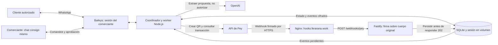

# Youtube Demo - https://youtu.be/THDkVN99KZc

# Youtube Short - https://www.youtube.com/shorts/MIbRi7ey3kc


**[▶ Descargar el video — Ya cayó el biyuyo (2:41)](docs/ux/demo/ya-cayo-el-biyuyo.mp4)**

# Ya cayó el biyuyo

El repositorio reúne el diseño y la demo del producto. La integración del servicio desplegado al código principal está propuesta en el [PR #5](https://github.com/feraranas/pey-hackathon/pull/5). Para el alcance y las verificaciones necesarias para una entrega, consulta el [plan de entrega](docs/plan-entrega.md).

**Cobros CoDi por WhatsApp para quien vive de su oficio.** Un agente observa los chats con clientes que el comerciante elige. Cuando detecta un trabajo acordado, le pregunta en privado si quiere enviar un QR de pey con el desglose. Solo con su "sí" lo envía al cliente correcto, y avisa cuando pey confirma el pago.

## El problema

Mecánicos, hojalateros, plomeros, electricistas y otros oficios cobran por WhatsApp: mandan una foto de su CLABE, el cliente la da de alta, transfiere y envía una captura. Después hay que cotejar las capturas contra el banco y recordar quién pagó en efectivo. El problema principal es **cobrar**, no administrar el taller.

## La propuesta

El comerciante habla con el agente en un chat con el número de WhatsApp del producto, «Agente de cobros», como con cualquier contacto. Sus clientes siguen hablando con él.

1. **Alta por WhatsApp:** el comerciante le escribe al número público del producto, da alias, nombre legal, CLABE y tipo de persona, y responde «Sí, autorizo». El agente la registra en pey y avisa que la activación puede tardar hasta cinco días hábiles.
2. **Detección:** el comerciante vincula su WhatsApp como dispositivo; en los chats elegidos, el agente identifica cuándo hay un trabajo y un monto acordados (texto primero; notas de voz opcionales).
3. **Autorización:** el agente le pregunta desde el número del producto, por ejemplo "¿Le envío a Ana el anticipo de $600?". Un **«Sí»** simple autoriza **un** cobro: el modelo entiende el lenguaje, pero el cliente, el monto y la versión salen del estado guardado. Si hay dos preguntas abiertas, el agente pregunta cuál.
4. **Cobro:** QR CoDi de monto fijo hacia la CLABE del comerciante, enviado desde el WhatsApp del comerciante, con su desglose, al cliente exacto.
5. **Confirmación:** un webhook firmado de pey, verificado contra la API, genera el aviso "Recibiste $600 (verificado por pey)", también desde el número del producto, con el saldo de la orden.

Una captura del cliente cuenta como *reportado, pendiente de verificar*, y el efectivo como *registrado por ti*. Solo pey confirma un pago.

## Cómo se ve


Ver el [flujo completo en pantallas](docs/ux/README.md) (maquetas ilustrativas con datos ficticios).

## Documentos

| Documento | Contenido |
|---|---|
| [docs/diseno.md](docs/diseno.md) | Uso, modelo de dominio, máquinas de estado, módulos, interfaces, esquema y reglas duras |
| [docs/implementacion.md](docs/implementacion.md) | Stack, cortes verticales con estimaciones, criterios de aceptación, puntos de corte, matriz de pruebas y demo |
| [docs/integraciones.md](docs/integraciones.md) | Contratos verificados de pey (8 nov 2026), webhooks, Baileys, OpenAI, versiones y pendientes |
| [docs/decisiones.md](docs/decisiones.md) | Alternativas comparadas y razones |
| [docs/diagramas.md](docs/diagramas.md) | Arquitectura, flujo de extremo a extremo y cuatro diagramas de estado |
| [docs/ux/README.md](docs/ux/README.md) | Flujo en 17 maquetas: alta con el número del producto, Rafa con su agente, dos clientes y el checkout CoDi (datos ficticios) |

## Stack sugerido

Node.js 24 LTS + TypeScript · Fastify · Baileys 7 · SQLite (WAL, `better-sqlite3`) · SDK de OpenAI con Zod · `standardwebhooks` · Vitest · Pino con redacción. Un solo servicio persistente con HTTPS y un volumen, sin Redis, colas externas ni microservicios. Ver [implementación](docs/implementacion.md#stack) y [decisiones](docs/decisiones.md).

## Alcance

**Incluye:** onboarding de la CLABE, órdenes con anticipo y saldo, QR CoDi, verificación de pagos, efectivo registrado y comprobantes reportados. Dos sesiones de WhatsApp en el mismo proceso: el número del producto, donde el comerciante habla con el agente, y el WhatsApp vinculado del comerciante, que lee a sus clientes y envía los cobros.

**No incluye:** ERP, inventario, facturación, diagnóstico, aprobación extra del cliente, links hospedados (sin `bankAccountId`), multi-sesión SaaS ni MCP de toda la API.

## Diagramas

Las fuentes canónicas son los archivos [`docs/diagrams/*.mmd`](docs/diagrams/). Los SVG, los PNG y [docs/diagramas.md](docs/diagramas.md) se generan con:

```bash
# Requiere Node >= 22.13 y Chrome; usa npx, sin dependencias en el repo
PUPPETEER_EXECUTABLE_PATH=/usr/bin/google-chrome node scripts/render-diagrams.mjs
node scripts/render-diagrams.mjs --check   # verifica que diagramas.md coincide con los .mmd
```

Para revisar los enlaces locales de la documentación: `python3 scripts/check-links.py`.

## Seguridad

Nunca se versionan secretos: la API key de pey, el secreto del webhook, la clave de OpenAI, la sesión de Baileys y las bases SQLite están excluidos en [.gitignore](.gitignore).

---

# Aplicación y guía de operación

Un coordinador de cobros para comerciantes: detecta acuerdos en chats autorizados, propone un cobro, exige aprobación del dueño y envía un QR CoDi de Pey. Un pago solo se acredita después de recibir un webhook firmado y consultar la API de Pey.

> **Estado al 8 de noviembre de 2026:** aplicación y despliegue implementados; la vinculación real de WhatsApp sigue bloqueada. No se ha validado un pago de extremo a extremo. `/health` y HTTPS funcionando no significan que el negocio esté listo para cobrar.

## Arquitectura del código actual



El [diseño del PR #1](https://github.com/feraranas/pey-hackathon/pull/1) y sus maquetas proponen **dos sesiones**: número del producto y número del comerciante. El código importado del commit `15075ba59ec1767d6a7a542de284c4680337cd1b` implementa **una sesión** y comandos en el chat propio. Este PR conserva esos documentos, pero no afirma haber implementado la experiencia de dos números.

## Probar sin cuentas ni pagos reales

Requiere Node 24 y herramientas de compilación para SQLite (Python 3, make y g++).

```bash
nvm use
npm ci
npm run check
npm test
npm run build
npm run demo
```

La demo usa proveedores simulados. No demuestra conectividad con WhatsApp ni confirma pagos reales.

### Aplicación completa en local (`npm run local`)

Arranca el coordinador, el runtime, el servidor de webhooks y el `PeyClient` reales. El cliente habla por HTTP con un sandbox de pey (`src/pey-sandbox.ts`) que firma webhooks con Standard Webhooks, y WhatsApp se simula en consola. No toca WhatsApp ni mueve dinero. Comandos: `p <texto>` (el comerciante al número del producto), `r <cliente> <texto>` (el comerciante en el chat del cliente), `c <cliente> <texto>` (el cliente), `foto <cliente>`, `activar` (pey activa la cuenta), `pagar` (el cliente paga el último QR), `salir`.

```text
p hola → alias → nombre legal → CLABE → física
p Sí, autorizo          # registra la cuenta en el sandbox (PENDING, aviso de 5 días hábiles)
p agrega a Ana 5215550000002
activar                 # webhook bank.account.updated → ACTIVE
r Ana Ana, balatas 800 y mano de obra 400, total 1200. Anticipo 600.
c Ana Va                # el producto pregunta: ¿Le envío a Ana…? Responde Sí o No.
p Sí                    # QR por el chat del comerciante
pagar                   # webhook firmado → «Recibiste $600.00 de Ana (verificado por pey)»
```

`test/e2e.test.ts` ejecuta ese recorrido por HTTP real, reenvía el webhook sin duplicar el aviso y comprueba que un webhook sin firma válida se rechaza. Para verificar también formato y enlaces: `npm run verify`.

## Configurar el servicio real

1. Copia `.env.example` a un archivo privado fuera del repositorio, con permisos `0600`.
2. Completa `PEY_API_KEY`, `PEY_API_KEY_ID`, `PEY_WEBHOOK_SECRET` y `OPENAI_API_KEY`. El ID de la API key no es la clave, el ID de la tienda ni el del QR. El secreto del webhook se obtiene al configurarlo en Pey.
3. Genera `SESSION_ENCRYPTION_KEY` con `openssl rand -hex 32`. Respalda la clave por separado y no la regeneres al actualizar.
4. Define `MERCHANT_JID` (WhatsApp del comerciante; `SELF_JID` es alias) y `PRODUCT_JID` (número dedicado del producto), con código de país, sin `+`, seguidos de `@s.whatsapp.net`. Deben ser distintos. Los clientes se agregan por chat con el producto; `ALLOWED_CHAT_JIDS` es una lista inicial opcional que no admite `*` ni a esos dos números.
5. Usa `WHATSAPP_PAIRING_MODE=qr` (predeterminado) o `code`. El código usa el número de cada sesión. Ambos métodos siguen pendientes de validación en esta VPS.
6. Configura `DATA_DIR`, `PUBLIC_BASE_URL` y `MERCHANT_ID`. Este último es una identidad interna estable, no un ID de Pey.

```bash
npm run build
node --env-file=/ruta/privada/pey.env dist/src/app.js
```

Escanea desde **WhatsApp → Dispositivos vinculados**. Los QR y códigos de vinculación son privados. El servicio verifica la identidad de las dos sesiones y envía una comprobación desde el número del producto al comerciante antes de habilitar comandos; nunca usa el chat del comerciante consigo mismo. Consulta la [guía de operación](docs/operacion.md) y el [despliegue en VPS](infra/pey/README.md).

## Cómo se cobra

Solo después de vincular WhatsApp y confirmar la cuenta bancaria `ACTIVE`:

1. En el chat propio: `ALTA Alias | Nombre legal | CLABE | PERSON`; revisa la propuesta y responde `ACEPTO código`. La activación no es inmediata.
2. Cotiza en un chat permitido. OpenAI extrae una propuesta; no puede autorizar ni enviar un cobro por sí solo.
3. Alternativamente: `COBRAR JID_DEL_CLIENTE | Concepto | 600 | 1200` propone un anticipo de 600 pesos para un total de 1200.
4. Aprueba con `SI código` o responde citando la propuesta con `sí`. Un sí aislado no autoriza.
5. El servicio crea y envía un QR. Una captura del cliente no confirma el pago.
6. Pey envía `codi.qr.payment_received`. El receptor valida firma y API key, persiste el evento y responde `202`; el worker consulta la transacción y coteja el cobro antes de acreditarlo.

`bank.account.updated` activa la revisión del estado bancario. No se usan payment links. `SALDO`, `EFECTIVO`, `NO`, `NUEVA` y otros comandos están descritos en la guía de operación.

## Estado real y pendientes

- Nginx termina HTTPS y dirige únicamente `/webhooks/pey` a `127.0.0.1:3000`; `/health` se consulta localmente.
- Se comprobó el rechazo `401` de un POST sin firma. No equivale a una entrega real procesada.
- Los códigos de vinculación fueron rechazados. Se observó una desconexión `401` con `registered=false`. Se respaldó y reinició solo la sesión; se cambió a Ubuntu + QR con contraste explícito.
- El último intento mostró un QR; el teléfono indicó continuar en WhatsApp Web/passkey y no se confirmó `connection=open` ni identidad verificada.
- Pendientes: vinculación, cuenta `ACTIVE`, entrega firmada real, consulta de transacción y aviso al comerciante. No declarar el sistema listo basándose solo en `/health`.

## Documentación y presentación

- [Operación del servicio](docs/operacion.md)
- [VPS, actualización, rollback y diagnóstico](infra/pey/README.md)
- [Diseño del producto](docs/diseno.md), [decisiones](docs/decisiones.md) y [contratos de integración](docs/integraciones.md)
- [Maquetas y presentación](docs/ux/README.md), [demo animada](docs/ux/demo/README.md)
- [Diagramas del diseño objetivo](docs/diagramas.md)

No versionar archivos privados de entorno, sesiones, bases de datos, logs, certificados, contraseñas ni salidas de trabajos. Baileys es una integración no oficial; la vinculación real debe verificarse antes de una prueba con pagos.


## Diagnóstico aislado de WhatsApp

Con Node 24 y dependencias instaladas (`npm ci`), ejecuta `node scripts/whatsapp-probe.mjs` desde una terminal privada. El diagnóstico usa credenciales temporales en memoria, no escucha puertos ni envía mensajes. El QR es privado; comparte únicamente las líneas `DIAGNÓSTICO:`. La sesión desaparece al terminar y podría dejar un dispositivo temporal en WhatsApp. Para inspeccionar el contenedor instalado, el script histórico `infra/pey/session/inspect-whatsapp.sh` requiere sudo y permisos sobre `pey-mvp`.
