# Diagramas

<!-- Archivo generado por scripts/render-diagrams.mjs. Edita los .mmd en docs/diagrams/ y vuelve a ejecutar el script. -->

Las fuentes canónicas están en [`docs/diagrams/`](diagrams/). Cada diagrama tiene su SVG y PNG renderizados con Mermaid CLI; los bloques `mermaid` de abajo se copian automáticamente de esas fuentes.

Regenerar: `PUPPETEER_EXECUTABLE_PATH=/usr/bin/google-chrome node scripts/render-diagrams.mjs` (ver [README](../README.md#diagramas)).

## Índice

1. [Arquitectura y flujo de datos](#arquitectura-y-flujo-de-datos)
2. [Flujo de extremo a extremo](#flujo-de-extremo-a-extremo)
3. [Estados: alta de la cuenta receptora](#estados-alta-de-la-cuenta-receptora)
4. [Estados: aprobación de un ChargeIntent](#estados-aprobación-de-un-chargeintent)
5. [Estados: creación del QR y entrega](#estados-creación-del-qr-y-entrega)
6. [Estados: pago por cobro y saldo de la orden](#estados-pago-por-cobro-y-saldo-de-la-orden)

## Arquitectura y flujo de datos

Componentes, datos y bordes de confirmación humana. Las líneas punteadas desde el chat del cliente son contexto: nunca otorgan autoridad.


Fuente: [`arquitectura.mmd`](diagrams/arquitectura.mmd) · [SVG](diagrams/arquitectura.svg) · [PNG](diagrams/arquitectura.png)

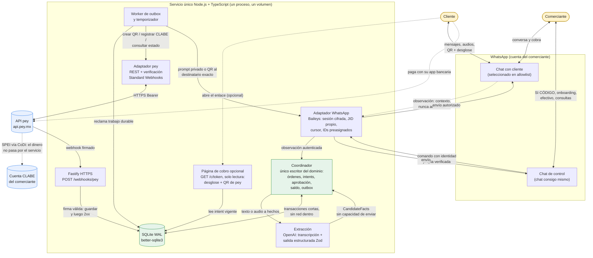

## Flujo de extremo a extremo

Desde que llega un mensaje hasta el aviso de pago verificado. Aprobación, creación del QR, entrega y pago son pasos distintos.


Fuente: [`flujo-e2e.mmd`](diagrams/flujo-e2e.mmd) · [SVG](diagrams/flujo-e2e.svg) · [PNG](diagrams/flujo-e2e.png)

```mermaid
flowchart TD
  A["Evento nuevo de Baileys"] --> B{"¿Chat en allowlist o chat<br/>de control, y evento no<br/>procesado antes del cursor?"}
  B -- No --> Z["Ignorar sin guardar contenido"]
  B -- Sí --> C{"¿Chat de control, fromMe,<br/>JID propio y ID que no<br/>es eco del bot?"}
  C -- "Sí: comando" --> J{"¿El sí se liga a una sola<br/>pregunta abierta y vigente?<br/>(estado, no el modelo)"}
  C -- "No: contexto de cliente<br/>o del comerciante" --> D["Extraer hechos con evidencia<br/>texto primero, audio opcional"]
  D --> E{"¿Trabajo y monto acordados<br/>sin ambigüedad?"}
  E -- No --> F["Esperar más contexto o pedir<br/>aclaración privada"]
  E -- Sí --> G["Crear o versionar WorkOrder<br/>y ChargeIntent con monto fijo:<br/>anticipo, saldo o total"]
  G --> H{"¿Cuenta receptora propia<br/>en ACTIVE?"}
  H -- No --> H2["Avisar en privado: cuenta<br/>pendiente; no ofrecer cobro real"]
  H -- Sí --> I["Pregunta privada natural:<br/>¿Le envío a Ana $1,200?"]
  I --> J
  J -- "No: 0 o 2+ abiertas,<br/>sustituida o vencida" --> F
  J -- Sí --> K{"¿Mismo digest, vigente,<br/>cuenta ACTIVE del mismo<br/>comerciante?"}
  K -- No --> L["Rechazar; proponer nueva versión"]
  K -- Sí --> M["Una transacción SQL: aprobación +<br/>trabajo de creación de QR"]
  M --> N["Worker: POST /codi/qr con amount fijo,<br/>bankAccountId, numRef, metadata, expiration"]
  N --> O{"¿Resultado?"}
  O -- "201" --> R["Guardar IDC y qrString;<br/>encolar entrega al JID exacto"]
  O -- "4xx definitivo" --> Q["Fallo conocido: avisar;<br/>no enviar nada"]
  O -- "timeout / 5xx / crash" --> P["Creación incierta: sin qrString<br/>no hay nada que enviar;<br/>nuevo intento solo con nuevo sí"]
  R --> S["Preasignar ID de mensaje, persistir,<br/>enviar imagen QR + desglose"]
  S --> T{"¿Eco o ack con ese ID?"}
  T -- Sí --> U["Entregado; no significa pagado"]
  T -- "Incierto" --> P2["Entrega incierta: revisión;<br/>nunca reenviar a ciegas"]
  WH["POST /webhooks/pey"] --> WV{"¿Firma Standard Webhooks<br/>válida?"}
  WV -- No --> WR["Rechazar 4xx; no guardar cuerpo"]
  WV -- Sí --> WS["Guardar crudo por webhook-id<br/>y responder 2xx"]
  WS --> WT["GET /transaction/transactionId:<br/>PAID, MXN, base, payableId"]
  WT --> WX{"¿IDC conocido, receptor,<br/>monto y estado coinciden?"}
  WX -- No --> WQ["Cuarentena o revisión;<br/>nunca marcar pagado"]
  WX -- Sí --> WP["Aplicar una vez por transactionId<br/>al ChargeIntent y al saldo de la orden"]
  WP --> WN["Aviso privado: recibiste $X por<br/>este cobro; saldo verificado y efectivo<br/>registrado por separado"]
  U -.-> WH
  P2 -.->|"el pago puede llegar igual"| WH
```

## Estados: alta de la cuenta receptora

Registro de la CLABE en pey. Solo `ACTIVE` habilita cobros reales; la activación puede tardar hasta cinco días hábiles.


Fuente: [`estado-onboarding.mmd`](diagrams/estado-onboarding.mmd) · [SVG](diagrams/estado-onboarding.svg) · [PNG](diagrams/estado-onboarding.png)

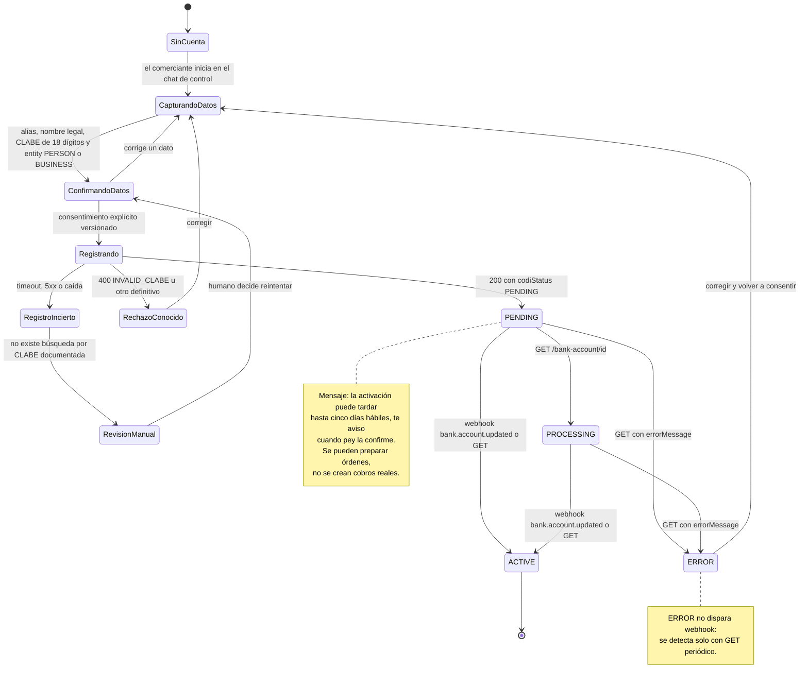

## Estados: aprobación de un ChargeIntent

Cada cobro (anticipo, saldo o total) se aprueba por separado y queda ligado a un digest inmutable.


Fuente: [`estado-aprobacion.mmd`](diagrams/estado-aprobacion.mmd) · [SVG](diagrams/estado-aprobacion.svg) · [PNG](diagrams/estado-aprobacion.png)

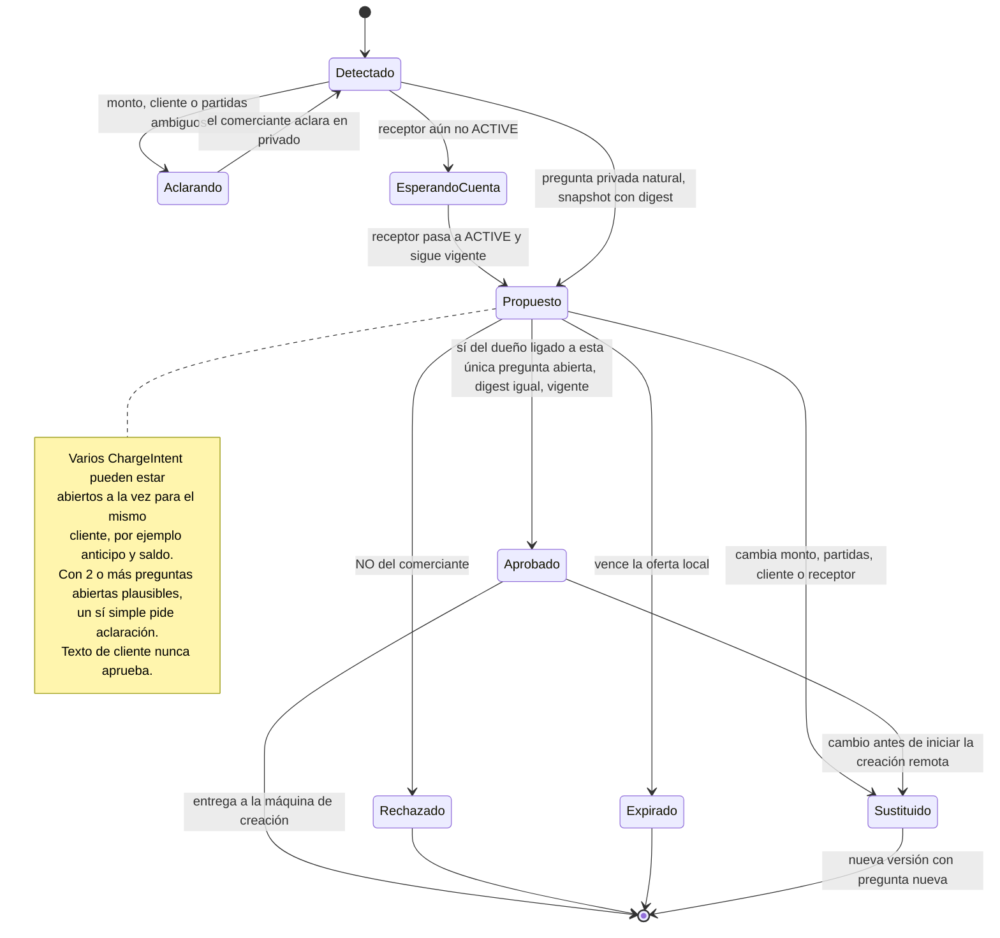

## Estados: creación del QR y entrega

Dos máquinas separadas. Los resultados inciertos van a revisión; no hay reintentos ciegos.


Fuente: [`estado-creacion-entrega.mmd`](diagrams/estado-creacion-entrega.mmd) · [SVG](diagrams/estado-creacion-entrega.svg) · [PNG](diagrams/estado-creacion-entrega.png)

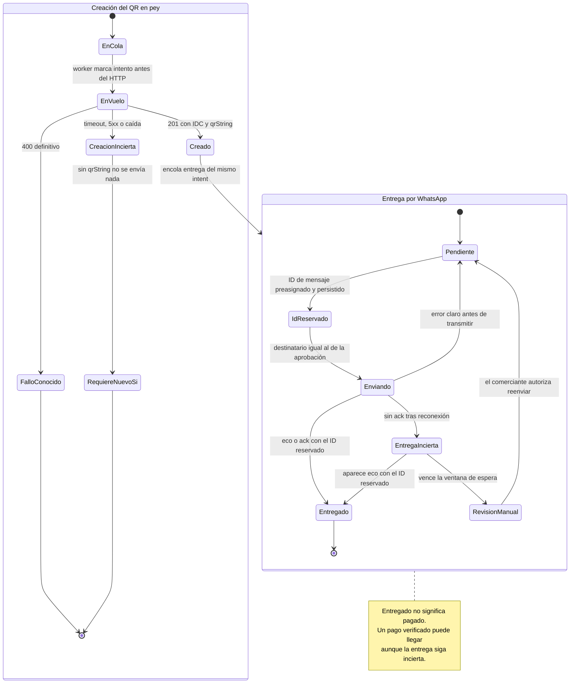

## Estados: pago por cobro y saldo de la orden

Un QR tiene monto fijo; el saldo se calcula a nivel WorkOrder sumando cobros verificados y, aparte, efectivo registrado.


Fuente: [`estado-pago-orden.mmd`](diagrams/estado-pago-orden.mmd) · [SVG](diagrams/estado-pago-orden.svg) · [PNG](diagrams/estado-pago-orden.png)

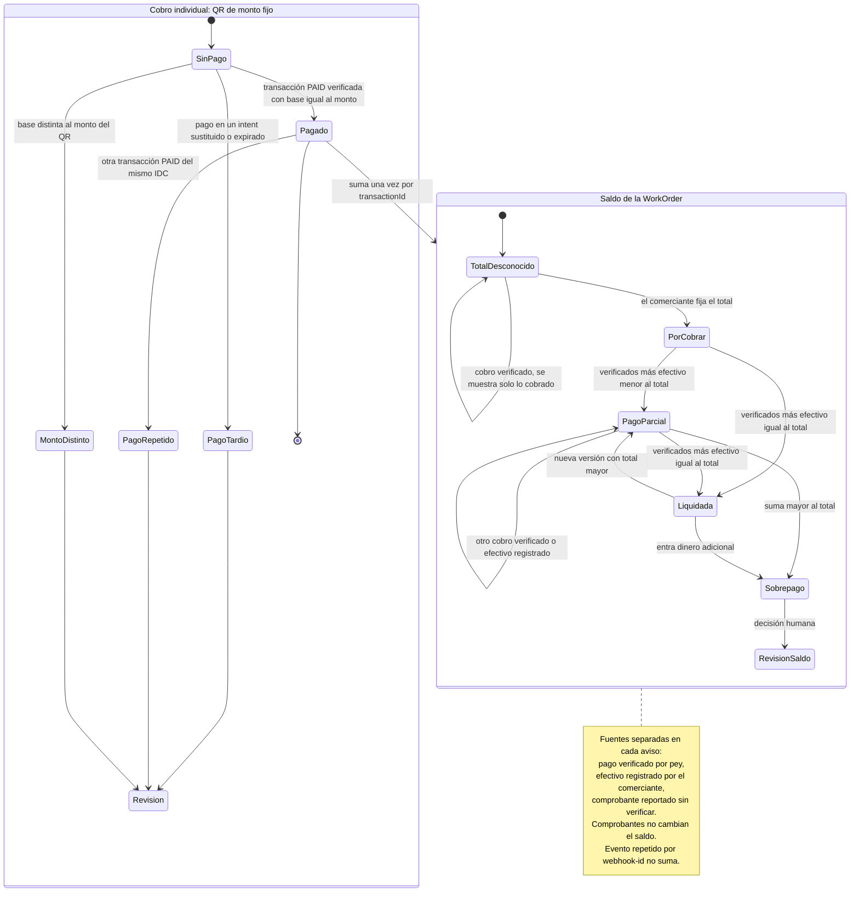
