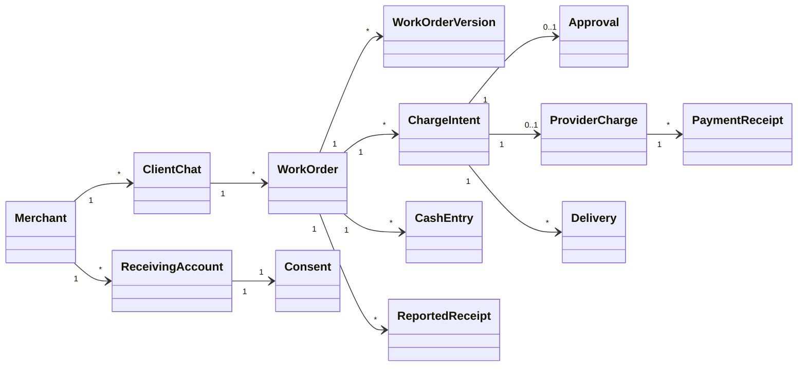

# Diseño

> Este documento define el diseño y el plan de construcción: tipos, interfaces y algoritmos en pseudocódigo. Todavía **no hay aplicación**. Los bloques de código son bocetos y no están pensados para compilarse.

## 1. Problema y alcance

Muchas personas con un oficio (mecánica, hojalatería, plomería, electricidad, costura...) cobran por WhatsApp. Hoy envían una foto de su CLABE, el cliente la da de alta, transfiere y manda una captura del comprobante. Después quien cobra tiene que revisar su banco y su memoria para saber quién ya pagó.

El producto es un **coordinador de cobros** que trabaja detrás del WhatsApp que esa persona ya usa:

1. Observa, desde el WhatsApp del comerciante vinculado como dispositivo, solo los chats con clientes que eligió.
2. Detecta cuándo ya acordaron un trabajo y un monto.
3. Desde el número de WhatsApp del producto («Agente de cobros»), le pregunta al comerciante: "¿Le envío a Ana el cobro de $1,200 por balatas y mano de obra?". El comerciante contesta "Sí".
4. Solo con ese "sí", ligado a la pregunta vigente (cliente, monto y versión), envía **un** QR CoDi de monto fijo con su desglose al cliente correcto, desde el WhatsApp del comerciante.
5. Cuando pey confirma el pago con un webhook firmado y verificado, avisa desde el número del producto: "Recibiste $1,200 de Ana por balatas y mano de obra (pago verificado por pey)".

**Dentro:** onboarding de la CLABE por WhatsApp, órdenes con anticipo y saldo, efectivo registrado por el comerciante, comprobantes marcados como reportados, y dos sesiones de WhatsApp en el mismo proceso: el número del producto (canal con el comerciante) y el WhatsApp vinculado de un comerciante de demo.

**Fuera:** ERP, inventario, facturación, diagnóstico, aprobación adicional obligatoria del cliente, multi-sesión SaaS, links hospedados (ver [integraciones](integraciones.md#link-de-pago-hospedado-sin-paridad-fuera-del-mvp)) y un servidor MCP que envuelva toda la API.

## 2. Uso: lo que vive cada persona

### Comerciante: alta de su cuenta (una vez)

```text
Comerciante → (al número público del producto) "Quiero cobrar con QR"
Agente      → "Necesito: alias, nombre legal del titular, CLABE (18 dígitos) y si es persona física o empresa."
Comerciante → "Taller Juárez / Juan Pérez López / 0121 8000 1234 5678 99 / persona"
Agente      → "Confirma: alias Taller Juárez · titular Juan Pérez López · CLABE ****5678 99 · PERSON.
               Declaro ser titular de esta cuenta y autorizo a <producto> a registrarla en pey
               para recibir cobros CoDi. Acepto los términos de pey (v2026-10-13).
               ¿Confirmas y autorizas el registro?"
Comerciante → "Sí, autorizo"
Agente      → "Listo, la registré. La activación puede tardar hasta cinco días hábiles; te aviso cuando pey la confirme."
Agente      → "Vincúlame a tu WhatsApp como dispositivo y dime qué chats leo."
```

Toda la conversación entre el comerciante y el agente ocurre en su chat con el número del producto: alta, propuestas de cobro, autorizaciones, avisos de pago y consultas. Ahí el agente aparece como un contacto más («Agente de cobros»). El consentimiento vale solo como respuesta del mismo remitente a la confirmación inmediatamente anterior, con los datos que esa confirmación mostró; si los datos cambian, se vuelve a preguntar.

Ese número **no puede leer** las conversaciones del comerciante con sus clientes. Para eso, al final del alta el comerciante vincula su WhatsApp como dispositivo (sesión `MERCHANT`) y elige qué chats lee el agente. Al vincular se verifica que el JID de esa sesión sea el mismo que escribe al número del producto. Los cobros autorizados salen de esa sesión, es decir, del WhatsApp del comerciante, hacia el chat exacto del cliente.

### Comerciante y cliente: un cobro

```text
[chat con Ana, seleccionado]
Comerciante → "Ana, son balatas $800 y mano de obra $400, total $1,200. Te pido $600 de anticipo."
Ana         → "Va, ¿cómo te pago?"

[chat con el número del producto]
Agente      → "Ana (…1234) · Orden: balatas $800 + mano de obra $400 = $1,200
               Este cobro: anticipo $600.00 MXN · vence en 24 h.
               ¿Le envío a Ana el anticipo de $600?"
Comerciante → "Sí"

[chat con Ana, desde el WhatsApp del comerciante]
Agente      → [imagen QR] "Anticipo para: balatas $800 + mano de obra $400 (total $1,200).
               Monto de este QR: $600.00 MXN. Paga desde tu app bancaria con CoDi."

[chat con el número del producto, tras el webhook verificado]
Agente      → "Recibiste $600.00 de Ana por el anticipo (pago verificado por pey).
               Orden: total $1,200 · verificado $600 · efectivo registrado $0 · falta $600."
```

El saldo se cobra igual: el agente pregunta «¿Le envío a Ana el saldo de $600?» y se repite el ciclo. El comerciante también puede escribir "Ana me dio 600 en efectivo": eso queda como **efectivo registrado por ti**, nunca como pago verificado. Si Ana manda una captura, el agente la marca como **reportado, pendiente de verificar** y no toca el saldo.

### Las tres llamadas del núcleo

```ts
// Pseudocódigo ilustrativo, no ejecutable.
await coordinator.observe(authenticatedObservation); // accepted | duplicate | ignored
await coordinator.command(authorizedMerchantCommand); // accepted | clarification | rejected
await coordinator.payment(verifiedPaymentNotice);     // applied | duplicate | quarantined
await coordinator.tick(now);                          // vencimientos, consultas de estado, outbox
```

Cada adaptador entrega datos ya autenticados. El texto de un cliente nunca llega como `command`.

## 3. Modelo de dominio



| Entidad | Qué representa | Invariantes |
|---|---|---|
| `Merchant` | La persona que cobra; dueña del WhatsApp vinculado | Su JID normalizado (número y LID) es a la vez el remitente autorizado en el número del producto y el JID propio de su sesión `MERCHANT` |
| `WaSession` | Una sesión Baileys del proceso | Rol `PRODUCT` (número del producto, canal de control) o `MERCHANT` (dispositivo vinculado del comerciante); una de cada en la demo |
| `ControlPrompt` | Una pregunta de cobro enviada desde el número del producto | Ligada a un intent y su digest; `Abierta → Respondida/Sustituida/Vencida`; la que resuelve un «sí» |
| `ReceivingAccount` | Su CLABE registrada en pey (`bankAccountId`) | Pertenece a un solo comerciante; cobra solo en `ACTIVE`; CLABE cifrada en reposo |
| `Consent` | Texto, versión, mensaje y fecha de la aceptación | Documenta autorización; **no prueba titularidad** |
| `ClientChat` | Un chat 1:1 elegido explícitamente | Allowlist; grupos apagados por defecto |
| `WorkOrder` | El trabajo acordado con un cliente | `total` fijo **o** `UNKNOWN` explícito; cada revisión crea una `WorkOrderVersion` |
| `ChargeIntent` | Un cobro concreto: `DEPOSIT`, `BALANCE`, `FULL` o `EXTRA` | Monto fijo > 0; snapshot inmutable con digest; destinatario y receptor fijos |
| `Approval` | El "sí" del comerciante para **ese** intent | Uno por intent; digest igual; identidad del dueño; dentro de vigencia |
| `ProviderCharge` | El QR creado en pey (IDC, `qrString`, `numRef`) | Uno por intent; monto del QR = monto del intent |
| `Delivery` | El envío del QR y desglose por WhatsApp | ID de mensaje preasignado; destinatario = el del intent |
| `PaymentReceipt` | Una transacción verificada de pey | Único por `transactionId`; suma al saldo una sola vez |
| `CashEntry` | Efectivo que el comerciante dice haber recibido | Fuente "registrado por ti"; nunca verificado |
| `ReportedReceipt` | Foto de comprobante enviada por el cliente | No cambia el saldo |

**Dinero:** `Centavos` es un entero (`bigint` o `INTEGER` en SQLite). La moneda es siempre MXN. La frontera con pey convierte pesos decimales con la regla estricta de [integraciones](integraciones.md#post-codiqr).

**Saldo de una orden** (derivado, nunca editable):

```text
verificado  = Σ PaymentReceipt.amount  (únicos por transactionId, estado PAID, receptor correcto)
efectivo    = Σ CashEntry.amount
pendiente   = total − verificado − efectivo        (solo si total ≠ UNKNOWN)
sobrepago   = pendiente < 0  → revisión, nunca se trunca a cero
```

Cada aviso muestra las tres fuentes por separado. Un QR es de **monto fijo**: no existe el "pago parcial de un QR". Lo parcial ocurre a nivel orden, con varios intents aprobados uno por uno. Si un QR recibe un monto distinto o un segundo pago, va a revisión.

**Revisiones:** cambiar total, partidas, cliente o receptor crea una nueva versión. Los intents que todavía no se aprueban o no se crean en pey pasan a `Sustituido`. Los QR **ya entregados no se pueden cancelar por API** (no hay endpoint documentado): siguen vigentes hasta su `expiration`. Si se pagan, el dinero se aplica a la orden como verificado y se etiqueta "pagado sobre versión anterior" para revisión.

## 4. Máquinas de estado separadas

Cada intent tiene **cuatro** estados independientes. Ninguno implica a otro: aprobado no es pagado, enviado no es pagado, y un pago verificado puede llegar aunque la entrega haya quedado incierta.

| Máquina | Estados | Diagrama |
|---|---|---|
| Onboarding de cuenta | `SinCuenta → CapturandoDatos → ConfirmandoDatos → Registrando → PENDING/PROCESSING → ACTIVE/ERROR` | [estado-onboarding](diagramas.md#estados-alta-de-la-cuenta-receptora) |
| Aprobación | `Detectado → Propuesto → Aprobado/Rechazado/Expirado/Sustituido` | [estado-aprobacion](diagramas.md#estados-aprobación-de-un-chargeintent) |
| Creación remota | `EnCola → EnVuelo → Creado/FalloConocido/CreacionIncierta` | [estado-creacion-entrega](diagramas.md#estados-creación-del-qr-y-entrega) |
| Entrega | `Pendiente → IdReservado → Enviando → Entregado/EntregaIncierta → RevisionManual` | mismo diagrama |
| Liquidación (por intent) | `SinPago → Pagado/MontoDistinto/PagoRepetido/PagoTardio → Revision` | [estado-pago-orden](diagramas.md#estados-pago-por-cobro-y-saldo-de-la-orden) |
| Saldo (por orden) | `TotalDesconocido/PorCobrar → PagoParcial → Liquidada/Sobrepago` | mismo diagrama |

## 5. Módulos

Un solo proceso Node.js. Se elige así para que cada invariante tenga un solo dueño.

| Módulo | Sabe | Expone | No hace |
|---|---|---|---|
| `coordinator/` | Órdenes, intents, aprobación, saldo, outbox, transacciones SQL | `observe`, `command`, `payment`, `tick` | Llamadas de red |
| `whatsapp/` | Dos sesiones Baileys (`PRODUCT` y `MERCHANT`), JIDs, cursor por sesión, IDs preasignados, ecos, medios, exclusión del chat con el producto | Observaciones autenticadas y `deliver(outboxItem)` por la sesión que le toca | Reglas de negocio |
| `pey/` | HTTP, Bearer, errores, Standard Webhooks, conversión de montos | `registerAccount`, `getAccount`, `createQr`, `getTransaction`, `listQrTransactions`, `verifyWebhook` | Decidir si algo está pagado |
| `extraction/` | Transcripción y salida estructurada | `CandidateFacts` con evidencia | Enviar, cobrar o escribir SQL |
| `app.ts` | Arranque de Fastify, socket, temporizador y cierre ordenado | — | — |

No hay capas repository/service/controller de paso. El camino normal se lee en tres saltos: adaptador → coordinador → adaptador.

## 6. Interfaces (boceto)

```ts
// Boceto de tipos. Los cuerpos se escriben en la implementación.
type Centavos = bigint;
type Money = { currency: 'MXN'; amount: Centavos };

type AuthenticatedObservation =
  | { kind: 'client_chat'; session: 'MERCHANT'; chatJid: ChatJid; messageId: WaMessageId;
      fromMe: boolean; at: Instant; text?: string; audioRef?: MediaRef; imageRef?: MediaRef }
      // solo chats de la allowlist; el chat del comerciante con el número del producto nunca llega aquí
  | { kind: 'merchant_command'; session: 'PRODUCT'; merchantId: MerchantId; senderJid: ChatJid;
      messageId: WaMessageId; at: Instant; text: string; quotedMessageId?: WaMessageId };
      // ya verificado: chat 1:1, fromMe=false, senderJid = JID registrado del comerciante,
      // ID que no está en outbox (no es eco del producto)
// El modelo interpreta el lenguaje ("sí", "mándaselo", "el de Luis") y, si lo hay, el cliente mencionado.
// Nunca elige monto ni intent: eso lo resuelve resolvePendingFocus con el estado guardado.

type MerchantCommand =
  | { kind: 'approve'; clientHint: string | null; quotedPromptId: WaMessageId | null; messageId: WaMessageId }
  | { kind: 'reject'; clientHint: string | null; quotedPromptId: WaMessageId | null; messageId: WaMessageId }
  | { kind: 'onboarding_data'; raw: string; messageId: WaMessageId }
  | { kind: 'consent'; confirmationPromptId: WaMessageId; messageId: WaMessageId }   // "Sí, autorizo" / "Acepto"
  | { kind: 'cash'; amount: Money; clientHint: string; messageId: WaMessageId }
  | { kind: 'set_total'; workOrderRef: string; total: Money | 'UNKNOWN'; messageId: WaMessageId };

type ChargeIntentSnapshot = Readonly<{
  id: ChargeIntentId; code: string /* opaco e interno: token del enlace, nunca se pide al comerciante */; workOrderId: WorkOrderId; workOrderVersion: number;
  kind: 'DEPOSIT' | 'BALANCE' | 'FULL' | 'EXTRA';
  recipientJid: ChatJid; receivingAccountId: ReceivingAccountId;
  lines: readonly { description: string; amount: Centavos }[];
  orderTotal: Centavos | 'UNKNOWN'; amount: Money; expiresAt: Instant;
  evidence: readonly WaMessageId[]; digest: string;   // hash de todos los campos anteriores
}>;

type CandidateFacts = {                 // salida del modelo, validada con Zod
  agreed: boolean; lines: { description: string; amountText: string }[];
  totalText?: string; requestedNowText?: string; ambiguities: string[];
  evidence: WaMessageId[];              // IDs de los mensajes que sostienen cada dato
};

type VerifiedPaymentNotice = {
  webhookId: string; transactionId: string; codiQrId: string;
  bankAccountId?: string; receiverClabe?: string;
  amount: Money; status: 'PAID'; datePaid: Instant;
};

interface Coordinator {
  observe(o: AuthenticatedObservation): Promise<'accepted' | 'duplicate' | 'ignored'>;
  command(c: MerchantCommand): Promise<'accepted' | 'clarification' | 'rejected'>;
  payment(p: VerifiedPaymentNotice): Promise<'applied' | 'duplicate' | 'quarantined'>;
  tick(now: Instant): Promise<void>;
}
```

### Algoritmos clave (pseudocódigo)

```text
resolvePendingFocus(command, now):                       // determinista; el modelo no participa
  abiertas ← ControlPrompt en Abierta enviados por el número del producto a ese comerciante,
             con intent en Propuesto y vigente
  si command.quotedPromptId → foco ← la pregunta citada (citar es opcional, nunca obligatorio)
  si no, si command.clientHint → foco ← la única pregunta abierta de ese cliente
  si no, si hay exactamente una abierta → foco ← esa (la última pregunta)
  cualquier otro caso (0, o 2+ plausibles) → clarification
      ("¿Cuál envío: Ana $1,200 o Luis $1,600?"), sin enviar nada
  // Una corrección de precio sustituye el intent y su pregunta deja de estar abierta:
  // un "sí" posterior se liga a la pregunta nueva o pide aclaración, nunca a la vieja.

authorize(command, now):
  intent ← resolvePendingFocus(command, now)
  un "sí" autoriza exactamente un intent; nunca varios a la vez
  si intent.estado ≠ Propuesto o now > intent.expiresAt → rejected (ofrecer nueva versión)
  si digest(recalcular snapshot) ≠ intent.digest → rejected
  si cuenta receptora ≠ ACTIVE o de otro comerciante → rejected
  TX corta: INSERT approval (UNIQUE intent_id, UNIQUE command_message_id)
            + INSERT job crear_qr (UNIQUE intent_id)
  // sin red dentro de la transacción

crear_qr(job):
  TX: job.estado EnCola → EnVuelo                       // intención registrada antes del efecto
  respuesta ← pey.createQr(amount=pesos(intent.amount), bankAccountId, numRef, metadata, expiration)
  201       → TX: guardar IDC y qrString; encolar delivery
  400       → TX: FalloConocido; avisar al comerciante
  incierto  → TX: CreacionIncierta; avisar "no pude confirmar el QR; responde SI de nuevo para otro intento"
  // Sin qrString no hay nada entregable. El reintento usa un numRef nuevo y una aprobación nueva.

deliver(item):
  si item.waMessageId vacío → TX: preasignar ID (generateMessageIDV2) y persistir
  verificar item.recipientJid = intent.recipientJid    // también lo impone la FK compuesta
  enviar(imagen QR + desglose, messageId = item.waMessageId)
  ack o eco con ese ID → Entregado | error antes de transmitir → Pendiente | sin señal → EntregaIncierta

webhook(raw, headers):
  si !standardwebhooks.verify(raw, headers) → 401, no guardar el cuerpo
  TX: INSERT webhook_events(webhook_id UNIQUE, raw cifrado) ON CONFLICT → 200 duplicado
  responder 200; el worker procesa después:
    tx ← pey.getTransaction(transactionId)
    validar PAID, MXN, CODI, API_CODI_QR, IDC conocido, receptor, base == intent.amount
    TX: INSERT payment_receipts(transaction_id UNIQUE) → recalcular saldo → encolar aviso
    discrepancia → quarantine + aviso de revisión
```

## 7. Persistencia (SQLite en WAL)

Restricciones que hacen cumplir las reglas aunque el código falle:

```sql
-- Boceto de esquema.
merchants(id PK, merchant_jid UNIQUE, merchant_lid UNIQUE NULL)       -- remitente autorizado y JID de su sesión MERCHANT
wa_sessions(id PK, role CHECK (role IN ('PRODUCT','MERCHANT')), own_jid UNIQUE, merchant_id FK NULL,
            CHECK ((role = 'MERCHANT') = (merchant_id IS NOT NULL)))
control_prompts(id PK, merchant_id FK, intent_id FK, intent_digest, wa_message_id UNIQUE,
                state CHECK (state IN ('OPEN','ANSWERED','SUPERSEDED','EXPIRED')), sent_at)
receiving_accounts(id PK, merchant_id FK, provider_bank_account_id UNIQUE, clabe_enc, clabe_last4,
                   entity CHECK (entity IN ('PERSON','BUSINESS')),
                   codi_status CHECK (codi_status IN ('PENDING','PROCESSING','ACTIVE','ERROR')),
                   consent_id FK, UNIQUE(id, merchant_id))
consents(id PK, merchant_id FK, text, version, digest, command_message_id UNIQUE, accepted_at)
client_chats(id PK, merchant_id FK, chat_jid, allowed, UNIQUE(merchant_id, chat_jid))
                                                   -- el JID del número del producto nunca puede estar aquí
wa_events(session_id, chat_jid, message_id, at, PRIMARY KEY(session_id, chat_jid, message_id))
wa_cursor(session_id PK, paired_at, last_processed_at)
work_orders(id PK, merchant_id FK, client_chat_id FK, current_version)
work_order_versions(work_order_id FK, version, total_cents NULL CHECK (total_cents IS NULL OR total_cents > 0),
                    total_known INTEGER CHECK (total_known IN (0,1)), lines_json, PRIMARY KEY(work_order_id, version))
charge_intents(id PK, code UNIQUE, merchant_id FK, work_order_id FK, work_order_version, kind, recipient_jid,
               receiving_account_id, amount_cents CHECK (amount_cents > 0), digest, expires_at,
               approval_state, UNIQUE(id, recipient_jid),
               FOREIGN KEY(receiving_account_id, merchant_id) REFERENCES receiving_accounts(id, merchant_id))
approvals(intent_id PK FK, digest, prompt_id FK UNIQUE, command_message_id UNIQUE, approved_at)
provider_charges(intent_id PK FK, creation_state, num_ref UNIQUE, codi_qr_id UNIQUE NULL, qr_string_enc NULL)
outbox(id PK, kind, session_role CHECK (session_role IN ('PRODUCT','MERCHANT')), aggregate_id,
       semantic_key UNIQUE, intent_id NULL, recipient_jid, wa_message_id UNIQUE NULL,
       CHECK ((kind = 'CHARGE') = (session_role = 'MERCHANT')),   -- cobros solo por la sesión del comerciante
       state, next_attempt_at, FOREIGN KEY(intent_id, recipient_jid) REFERENCES charge_intents(id, recipient_jid))
webhook_events(webhook_id PK, received_at, type, raw_enc, processed_state)
payment_receipts(transaction_id PK, intent_id FK, codi_qr_id, amount_cents, verified_at, flags)
cash_entries(id PK, work_order_id FK, amount_cents CHECK (amount_cents > 0), command_message_id UNIQUE)
reported_receipts(id PK, work_order_id FK NULL, media_ref, extracted_amount_cents NULL)
reviews(id PK, kind, aggregate_id, opened_at, resolved_at NULL)
```

- **Destinatario exacto:** la FK compuesta `outbox(intent_id, recipient_jid) → charge_intents(id, recipient_jid)` impide encolar un QR hacia otro chat. `semantic_key` (`intent:<id>:qr`) impide encolarlo dos veces.
- **Deduplicación en dos niveles:** `webhook_events.webhook_id` evita reprocesar la misma entrega, y `payment_receipts.transaction_id` evita sumar el mismo dinero dos veces aunque llegue en eventos distintos.
- **Transacciones cortas:** compare-and-set de estado más inserción en outbox. Ninguna llamada de red ocurre con la base bloqueada. Hay un solo worker.
- **Respaldo:** el archivo SQLite y la sesión cifrada viven en un volumen persistente con respaldo probado.

## 8. Identidad y autoridad en WhatsApp

- **Dos sesiones, dos papeles.** `PRODUCT` es el número del producto: solo conversa con comerciantes registrados y es el único canal de comandos. `MERCHANT` es el WhatsApp del comerciante vinculado como dispositivo: lee los chats de la allowlist y envía los cobros aprobados. En la demo corren en el mismo proceso (una sesión de cada una). La WhatsApp Cloud API para el número del producto queda como evolución; no se asume configurada.
- **Allowlist:** en la sesión `MERCHANT` solo se procesan los chats elegidos. Los grupos están apagados por defecto. De los chats no elegidos no se guarda contenido.
- **Exclusión del chat con el producto:** en la sesión `MERCHANT`, el chat del comerciante con el número del producto se descarta siempre, antes del detector. Esos mensajes ya llegan por la sesión `PRODUCT`; procesarlos también aquí duplicaría comandos o haría que el detector leyera las propuestas del agente como una cotización (un bucle).
- **Comandos:** un mensaje es comando solo si llega a la sesión `PRODUCT`, en un chat 1:1, con `fromMe = false`, con remitente igual al JID registrado del comerciante (número o LID normalizados) **y** con un ID que no está en `outbox.wa_message_id`. Lo que envía el propio número del producto llega con `fromMe = true` y nunca se interpreta como comando. Los IDs del bot se preasignan y persisten **antes** de enviar en ambas sesiones. Si la sesión real no permite verificar el remitente, los comandos se deshabilitan hasta corregir el adaptador.
- **`fromMe` en el chat de un cliente** (sesión `MERCHANT`) es contexto: el comerciante cotizando. Nunca es un comando. Los cobros que envía el agente desde esa sesión también son `fromMe`; se reconocen por su ID preasignado y no se reprocesan como cotización.
- **Inyección:** un cliente que escribe "sí, mándalo", "soy el dueño" o "cambia la CLABE", o que lo pone en una imagen o un audio, solo aporta datos a la extracción. La autoridad nunca viene del contenido.
- **Audio:** el remitente lo da el sobre del mensaje. Un audio reenviado no prueba quién habla.
- **Reinicios:** un cursor persistente por sesión, fijado al momento del emparejamiento, junto con `wa_events` UNIQUE, evita reprocesar. Los mensajes que llegaron mientras el servicio estaba caído **sí** se procesan. Un "sí" recibido así se resuelve con el estado al procesarse: si su pregunta ya se sustituyó, venció o hay otra abierta posterior, se pide aclaración en lugar de enviar. Si ya venció, se pide uno nuevo. La sincronización de historial anterior al emparejamiento se ignora.
- **Secretos:** las dos sesiones de Baileys, la API key, el secreto `whsec_` y la clave de OpenAI van en variables de entorno o en archivos fuera del repositorio. La sesión se cifra en reposo y Pino redacta CLABE, tokens y cuerpos de webhook.

## 8b. Página de cobro (opcional)

El comerciante habla de «enlace de pago», y para el cliente es más cómodo tocar un enlace que recibir una imagen. Como el link hospedado de pey no puede dirigir el dinero a la CLABE de cada comerciante, el enlace apunta a una **página propia de solo lectura**:

- `GET /c/<token>` muestra negocio, desglose, monto y el `qrString` de pey renderizado como QR, junto con la vigencia.
- El token del enlace es opaco y no se puede adivinar (en las maquetas, `k7Q2mX`). Es interno: aparece en la URL, pero nunca se le pide al comerciante ni se usa como clave de autorización. La página no crea cobros, no cambia estados y no pide datos al cliente.
- Si el intent está sustituido, vencido o ya pagado, la página lo dice y no muestra el QR.
- El mensaje del cliente sigue llevando el desglose completo. La página es un complemento, no un requisito.
- **Pendiente de probar:** cómo se paga un QR abierto en el mismo teléfono depende de cada banco. Mientras no se pruebe, la página muestra el QR y una instrucción honesta, sin prometer que se pueda pagar con un toque.

Flujo en pantallas: [docs/ux](ux/README.md).

## 9. Reglas duras (checklist)

1. Ningún mensaje sale hacia un cliente sin un `Approval` del comerciante para ese intent exacto.
2. Un "sí" natural del comerciante, enviado al número del producto, se liga a la última pregunta de cobro abierta en ese chat (intent, cliente, monto y versión). Si hay dos o más plausibles, o la pregunta quedó sustituida o vencida, se pide aclaración y no se envía nada. No se exigen códigos ni citas.
3. Solo un mensaje entrante del comerciante registrado al número del producto (`fromMe = false`, remitente verificado, no eco) puede aprobar. Nada que pase en la sesión `MERCHANT` aprueba.
4. Snapshot inmutable: cualquier cambio de monto, partidas, cliente o receptor genera un intent nuevo y una pregunta nueva; la anterior se invalida.
5. El QR va solo a `recipient_jid` del intent (FK compuesta) y una sola vez (`semantic_key`).
6. El modelo propone hechos. No envía, no cobra, no escribe en la base y no cambia la cuenta.
7. Solo se cobra hacia una `ReceivingAccount` en `ACTIVE` del mismo comerciante. `bankAccountId` siempre va explícito.
8. Los montos se manejan en centavos enteros. El QR nunca lleva `amount = 0`.
9. Pagado verificado exige webhook firmado y `GET /transaction` coincidente. Una captura es solo reportada; el efectivo es registrado por el comerciante.
10. No hay exactly-once: un resultado incierto va a revisión o a una nueva aprobación, nunca a un reintento ciego.
11. Ninguna llamada de red ocurre dentro de una transacción SQL.
12. El onboarding pide solo alias, nombre legal, CLABE y `entity`, más un consentimiento versionado. La activación puede tardar hasta cinco días hábiles.
