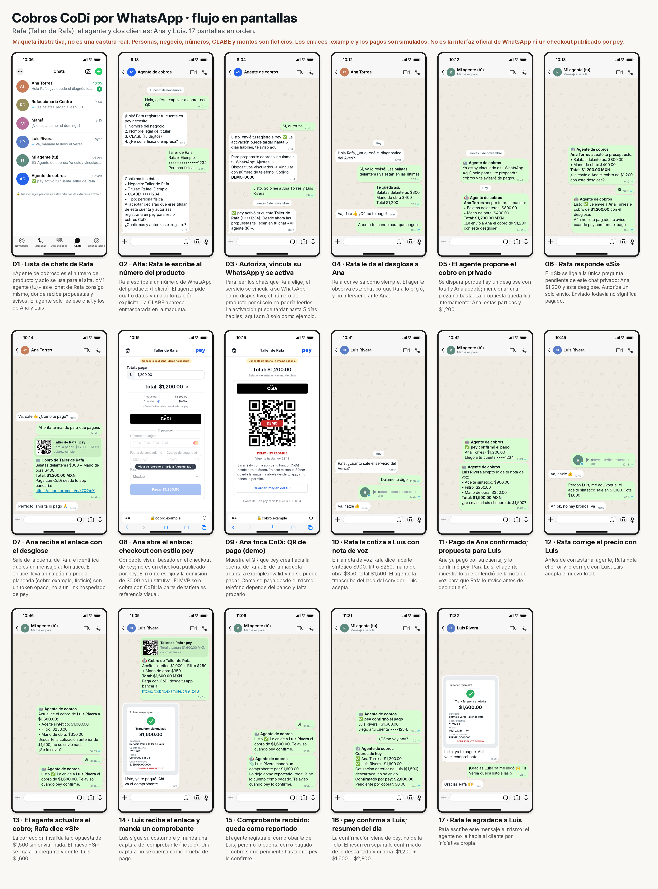

# Flujo en pantallas de WhatsApp

> **Maqueta ilustrativa.** Ninguna pantalla es una captura real. Personas, negocio, CLABE y montos son ficticios. Los enlaces usan dominios reservados (`cobro.example`, `example.invalid`) y todos los pagos son simulados. No es la interfaz oficial de WhatsApp ni un checkout publicado por pey, y no se conectó ninguna cuenta ni se envió ningún mensaje.



## Cómo leerlo

- **Perspectiva:** todo se ve desde el teléfono de **Rafa** (Taller de Rafa), salvo las pantallas 08 y 09, que muestran lo que ve Ana al abrir el enlace.
- **Alta con el número del producto (02–03):** Rafa le escribe a «Agente de cobros», un número público de WhatsApp del producto. Ahí el agente aparece en blanco y Rafa en verde, como en cualquier chat. Ese número solo se usa para el alta: al final, Rafa vincula el servicio a su propio WhatsApp y elige qué chats lee.
- **«Mi agente (tú)» (05, 06, 11, 13, 15, 16)** es el chat de Rafa consigo mismo, guardado con ese nombre. Ahí llegan las propuestas, las autorizaciones y los avisos. Como el agente opera desde la sesión vinculada de Rafa, sus mensajes y los de Rafa **aparecen en verde**; por eso cada mensaje del agente empieza con «🤖 Agente de cobros».
- **En los chats con clientes**, todo lo que sale de la cuenta de Rafa es verde, lo escriba él o el agente. Lo que envía el agente empieza con «🤖 Cobro de Taller de Rafa».
- **Permiso con un «Sí» natural:** el agente pregunta en privado, por ejemplo «¿Le envío a Ana el cobro de $1,200 con este desglose?», y Rafa contesta «Sí». No hay códigos que escribir ni respuestas citadas obligatorias. El backend liga ese «sí» a la única pregunta abierta de ese chat (cliente, partidas, monto y versión). Si hubiera dos preguntas abiertas, el agente preguntaría cuál antes de enviar. Lo que escriba un cliente nunca autoriza un envío.
- **Una corrección invalida la propuesta anterior (12–13):** el agente descarta la cotización de $1,500 sin enviarla y vuelve a preguntar con el nuevo total.
- **Enviado no es pagado** y **comprobante no es pago**. Solo un aviso de pey verificado se cuenta como pago confirmado.

## Capítulos

| Capítulo | Pantallas | Qué muestra |
|---|---|---|
| [1 · Alta](mockups/storyboard-1.png) | 01–03 | Chats de Rafa, alta con el número del producto, «Sí, autorizo», vinculación y activación |
| [2 · Ana](mockups/storyboard-2.png) | 04–09 | Desglose, pregunta privada, «Sí», enlace, checkout estilo pey y QR CoDi |
| [3 · Luis](mockups/storyboard-3.png) | 10–13 | Nota de voz, propuesta, corrección de precio, pregunta nueva y «Sí» |
| [4 · Confirmaciones](mockups/storyboard-4.png) | 14–17 | Comprobante reportado, confirmación de pey, resumen del día y cierre de Rafa |

Montos que cuadran en todo el flujo: Ana $1,200 (800 + 400). Luis $1,600 (1,000 + 250 + 350); la cotización anterior de $1,500 se descartó sin enviarse. Confirmado por pey: $2,800; pendiente: $0.

## Pantallas

| # | Archivo | Qué pasa |
|---|---|---|
| 01 | [lista de chats](mockups/01-lista-de-chats-de-rafa.png) | «Agente de cobros» (alta) y «Mi agente (tú)» (operación diaria) |
| 02 | [alta: datos](mockups/02-alta-rafa-le-escribe-al-numero-del-producto.png) | Cuatro datos y una confirmación con la declaración de titularidad (CLABE enmascarada) |
| 03 | [alta: autorización y activación](mockups/03-autoriza-vincula-su-whatsapp-y-se-activa.png) | «Sí, autorizo», vinculación y «puede tardar hasta 5 días hábiles» |
| 04 | [Ana: desglose](mockups/04-rafa-le-da-el-desglose-a-ana.png) | Rafa cotiza como siempre y Ana acepta |
| 05 | [propuesta](mockups/05-el-agente-propone-el-cobro-en-privado.png) | «¿Le envío a Ana el cobro de $1,200 con este desglose?» |
| 06 | [«Sí»](mockups/06-rafa-responde-si.png) | Un «Sí» simple autoriza ese cobro; «aún no está pagado» |
| 07 | [Ana recibe el enlace](mockups/07-ana-recibe-el-enlace-con-el-desglose.png) | Mensaje automático con desglose y enlace (token opaco en la URL) |
| 08 | [checkout](mockups/08-ana-abre-el-enlace-checkout-con-estilo-pey.png) | Estilo del checkout de pey: total, productos, comisión ilustrativa de $0.00 y botón CoDi; tarjeta deshabilitada |
| 09 | [QR CoDi](mockups/09-ana-toca-codi-qr-de-pago-demo.png) | QR de demo no pagable e instrucción honesta para el mismo teléfono |
| 10 | [Luis: nota de voz](mockups/10-rafa-le-cotiza-a-luis-con-nota-de-voz.png) | La cotización llega por audio |
| 11 | [pago de Ana + propuesta](mockups/11-pago-de-ana-confirmado-propuesta-para-luis.png) | pey confirma a Ana; el agente muestra lo que entendió del audio |
| 12 | [corrección](mockups/12-rafa-corrige-el-precio-con-luis.png) | Rafa corrige el aceite a $1,000 |
| 13 | [pregunta nueva y «Sí»](mockups/13-el-agente-actualiza-el-cobro-rafa-dice-si.png) | «Actualicé el cobro de Luis a $1,600. ¿Se lo envío?» → «Sí» |
| 14 | [comprobante](mockups/14-luis-recibe-el-enlace-y-manda-un-comprobante.png) | Luis manda una captura (ficticia) |
| 15 | [comprobante reportado](mockups/15-comprobante-recibido-queda-como-reportado.png) | Queda como reportado, no como pagado |
| 16 | [confirmación y resumen](mockups/16-pey-confirma-a-luis-resumen-del-dia.png) | pey confirma; «cotización anterior de Luis descartada» |
| 17 | [cierre](mockups/17-rafa-le-agradece-a-luis.png) | Rafa escribe él mismo; el agente no inicia conversaciones con clientes |

## Qué entiende el modelo y qué fija el estado

| Lo decide el modelo | Lo decide el estado (determinista) |
|---|---|
| Si el mensaje de Rafa es un sí, un no o una corrección | A qué pregunta abierta se liga ese sí |
| Si menciona a un cliente («el de Luis») | Cliente, partidas, monto y versión del cobro (snapshot inmutable) |
| Partidas y total que se dijeron en un chat o un audio | Si la propuesta sigue vigente o ya se sustituyó |
| | Si hay ambigüedad (dos o más preguntas abiertas) y hay que aclarar antes de enviar |

Un «sí» autoriza un solo cobro. El «sí» de un cliente, un eco del bot o una respuesta a una propuesta vieja no autorizan nada. Ver la regla 2 del [diseño](../diseno.md#9-reglas-duras-checklist) y la [decisión 4](../decisiones.md#4-autorización-sí-natural-ligado-por-estado-no-por-códigos).

## El enlace `cobro.example`: página propia con estilo pey

Rafa pidió mandar un **enlace** de pago. El link hospedado de pey (`POST /payment-link/create`) no acepta `bankAccountId`, así que no puede dirigir el dinero a la CLABE de cada comerciante ([integraciones](../integraciones.md#link-de-pago-hospedado-sin-paridad-fuera-del-mvp)). La maqueta propone una **página propia, pequeña y de solo lectura** que imita el checkout de pey: `https://<dominio>/c/<token>` muestra el total, el desglose y, al tocar CoDi, el **QR que pey creó con `bankAccountId` explícito**. El token es opaco y nadie tiene que escribirlo. La página no crea cobros ni guarda datos del cliente. Ver [diseño](../diseno.md#8b-página-de-cobro-opcional).

- La comisión de $0.00 es ilustrativa y no está validada con pey.
- La sección de tarjeta se muestra deshabilitada solo como referencia visual: el MVP cobra con CoDi.
- Falta probarlo: cómo paga el cliente un QR que abre **en su mismo teléfono** depende de su banco. La pantalla 09 lo dice tal cual.

## Regenerar

```bash
python3 -m venv /tmp/mockvenv && /tmp/mockvenv/bin/pip install pillow qrcode
/tmp/mockvenv/bin/python docs/ux/render_mockups.py                 # PNG en docs/ux/mockups/
/tmp/mockvenv/bin/python docs/ux/render_mockups.py --zip /tmp/pey-whatsapp-mockups.zip
```

- [`screens.json`](screens.json) es la única fuente del texto de cada pantalla y de sus pies de foto.
- [`render_mockups.py`](render_mockups.py) dibuja con Pillow, a 2× (786 × 1704 px, proporción de 393 × 852 pt). Usa Inter y Noto Color Emoji; las rutas se cambian con `MOCKUP_FONT` y `MOCKUP_EMOJI_FONT`.
- El script ajusta el texto automáticamente y **falla** si el contenido de una pantalla no cabe, en vez de cortarlo.
